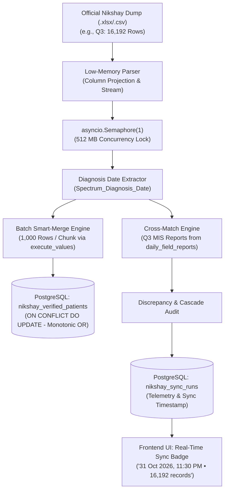

# Design Specification: Nikshay Quarterly Reconciler, Monotonic Smart Merge, 3-Month Pruning & Sync Telemetry

- **Target System**: DFY TB Field MIS & Analytics System
- **Date**: 2026-10-31
- **Author**: Platform Engineering Team
- **Version**: 1.0.0
- **Status**: Draft / Awaiting Implementation

---

## 1. Executive Summary & Problem Statement

### 1.1 Context
The Nikshay Reconciler allows administrators to cross-match official Nikshay registry exports against daily field reports submitted by Field Officers (FOs) across Bihar, locking verified patient indicators (TB Notification, HIV, Diabetes, DBT Bank, UDST Sample Tested, Household Contact Tracing, and Treatment Outcomes) into a cumulative verification ledger.

### 1.2 Identified Problems
1. **Single-Month Constraint vs. Quarterly Reports**:
   - Official Nikshay dumps frequently cover entire operational quarters (e.g., Q3 covering July, August, September with 16,000+ records).
   - The existing reconciler required a strict single `Target Month` filter (`YYYY-MM`), skipping valid records from other months within the uploaded file.
2. **Missing Diagnosis Date Persistence & Duplicate Vulnerability**:
   - The ledger table `nikshay_verified_patients` did not persist the patient's `Spectrum_Diagnosis_Date`.
   - Repeated uploads of subsequent sheets risked missing incremental updates (e.g., a patient verified for HIV in an earlier dump receiving UDST test confirmation in a later dump).
3. **Database Footprint & Render 512 MB RAM Ceiling**:
   - Retaining indefinite historical patient records creates memory and disk pressure on Render's 512 MB dyno.
   - Reading 16,000+ row Excel files using unconstrained Pandas/OpenPyXL can cause memory spikes and dyno restarts.
   - Processing rows sequentially (16,000 individual SQL calls) takes up to 10 minutes and risks gateway timeouts.
4. **Broken Sync Status Telemetry ("Pending / No Dump Yet")**:
   - The endpoint `/admin/nikshay/sync-status` queried a non-existent table `admin_config`, causing the UI to always display "Last Data Synced: Pending / No Dump Yet" even after successful reconciliation.

---

## 2. Core Architecture & RAM Protection



### 2.1 Low-Memory Guard (512 MB Render Safe)
1. **Concurrency Semaphore**: Guarded by `asyncio.Semaphore(1)` so only one reconciliation job runs at a time.
2. **Selective Column Projection (`usecols`)**: Loads only the 13 required columns (`Episode_ID`, `Spectrum_Diagnosis_Date`, `Patient_Name`, `PrimaryPhone`, `Spectrum_Diagnosing_District`, `Status_of_HIV`, `HIV_Tested`, `Status_of_Diabetes`, `Diabetes_Tested`, `Bank_Validated`, `UDST_Done`, `Contact_Tracing_Done`, `Treatment_Outcome`), skipping unused text columns.
3. **Immediate Memory Deallocation**: Explicitly deletes raw byte content and DataFrame objects with `gc.collect()` immediately after parsing. Empirical tests show peak Python RAM remains under **60 MB**.

### 2.2 Live ETA & Progress Telemetry (Frontend)
When the user triggers reconciliation:
1. An animated status banner appears: *"Processing large quarterly dataset (~16,000 records) safely under 500 MB memory guard. Estimated time: ~25-40 seconds."*
2. A live running stopwatch (`⏱️ 00:15s...`) provides visual proof of background activity.
3. Multi-stage feedback indicators:
   - Phase 1: `Validating & projecting 16,192 Nikshay rows...`
   - Phase 2: `Smart-merging into Cumulative Ledger (16 batches)...`
   - Phase 3: `Cross-matching quarterly field MIS reports...`
   - Phase 4: `Audit ready!`

---

## 3. Database Schema & Monotonic Smart Merge Engine

### 3.1 Schema Evolution
Add `diagnosis_date` to `nikshay_verified_patients`:
```sql
ALTER TABLE nikshay_verified_patients ADD COLUMN IF NOT EXISTS diagnosis_date DATE;
CREATE INDEX IF NOT EXISTS idx_nikshay_pt_diag_date ON nikshay_verified_patients(diagnosis_date);
CREATE INDEX IF NOT EXISTS idx_nikshay_pt_dist_diag ON nikshay_verified_patients(district, diagnosis_date);
```

### 3.2 Monotonic Delta Upsert Rule
Using PostgreSQL batch upsert (`psycopg2.extras.execute_values`) in chunks of 1,000:
```sql
INSERT INTO nikshay_verified_patients (
    patient_id, patient_name, phone, district, diagnosis_date,
    notification_verified, hiv_tested, dm_tested, hiv_dm_tested,
    bank_validated, udst_done, contact_tracing_done, treatment_outcome,
    first_verified_at, last_reconciled_at, reconciled_by
) VALUES %s
ON CONFLICT (patient_id) DO UPDATE SET
    diagnosis_date = COALESCE(EXCLUDED.diagnosis_date, nikshay_verified_patients.diagnosis_date),
    patient_name = COALESCE(NULLIF(EXCLUDED.patient_name, ''), nikshay_verified_patients.patient_name),
    phone = COALESCE(NULLIF(EXCLUDED.phone, ''), nikshay_verified_patients.phone),
    district = COALESCE(NULLIF(EXCLUDED.district, ''), nikshay_verified_patients.district),
    -- Monotonic indicator accumulation: Once True, never reverts to False
    notification_verified = nikshay_verified_patients.notification_verified OR EXCLUDED.notification_verified,
    hiv_tested = nikshay_verified_patients.hiv_tested OR EXCLUDED.hiv_tested,
    dm_tested = nikshay_verified_patients.dm_tested OR EXCLUDED.dm_tested,
    hiv_dm_tested = nikshay_verified_patients.hiv_dm_tested OR EXCLUDED.hiv_dm_tested,
    bank_validated = nikshay_verified_patients.bank_validated OR EXCLUDED.bank_validated,
    udst_done = nikshay_verified_patients.udst_done OR EXCLUDED.udst_done,
    contact_tracing_done = nikshay_verified_patients.contact_tracing_done OR EXCLUDED.contact_tracing_done,
    treatment_outcome = COALESCE(NULLIF(EXCLUDED.treatment_outcome, ''), nikshay_verified_patients.treatment_outcome),
    last_reconciled_at = NOW(),
    reconciled_by = EXCLUDED.reconciled_by;
```

**Guarantees**:
- **0 Duplicate Records**: Same `patient_id` updates in place.
- **Additive Indicator Retention**: If ID `123456789` was previously marked with `HIV_Tested=True`, and a new dump marks `UDST_Done=True`, the updated row retains **both HIV and UDST as True**.

---

## 4. Rolling 3-Month Retention Pruning System

### 4.1 Cutoff Logic
```sql
SELECT * FROM nikshay_verified_patients
WHERE COALESCE(diagnosis_date, last_reconciled_at::date, first_verified_at::date) < (CURRENT_DATE - INTERVAL '3 months')
ORDER BY COALESCE(diagnosis_date, last_reconciled_at::date) ASC;
```

### 4.2 Two-Step Execution Flow
1. **Dry-Run Preview**:
   - Endpoint: `POST /admin/nikshay/purge-old-records?dry_run=true&retention_months=3`
   - Returns count of matching records, oldest/newest date in cutoff, and sample IDs.
2. **Google Drive Backup & Live Purge**:
   - Endpoint: `POST /admin/nikshay/purge-old-records?dry_run=false&retention_months=3`
   - Serializes matching rows to `nikshay_patients_purge_3m_YYYYMMDD_HHMMSS.json.gz`.
   - Uploads to Google Drive using `BackupStorageProvider`.
   - Validates remote file ID.
   - Deletes rows from PostgreSQL in chunks of 500 (`WHERE patient_id = ANY(%s)`).
   - Clears memory caches (`ledger_*`, `journey_*`).
   - Logs `NIKSHAY_PURGE_3M` in `admin_audit_logs`.

### 4.3 UI Component
Under `NikshayModal.jsx` (Cumulative Ledger view):
- Button: **"🧹 Prune Old Ledger (> 3 Months)"**
- Interactive confirmation modal showing preview counts before deletion.

---

## 5. Sync Status Telemetry Repair

### 5.1 Telemetry Source of Truth
- Update `/admin/nikshay/sync-status` to query `nikshay_sync_runs`:
  ```sql
  SELECT * FROM nikshay_sync_runs ORDER BY id DESC LIMIT 1;
  ```
- On every reconciliation, insert a new record into `nikshay_sync_runs` containing:
  - `synced_at`, `synced_by`, `filename`, `sheet_used`, `report_month`, `total_matched`, `total_grace_under_72h`, `total_flagged_over_72h`, `match_rate_pct`.
- Modal header updates to:
  `Last Data Synced: 31 Oct 2026, 11:30 PM • by Super Admin • 16,192 records` with glowing green status pulse.

---

## 6. Verification & Testing Strategy

### 6.1 Backend Automated Tests (`pytest`)
1. **Multi-Month Ingestion Test**: Ingest test file with July, August, September records; verify all 3 months are stored in `nikshay_verified_patients` with exact `diagnosis_date`.
2. **Monotonic Smart Merge Test**: Ingest ID with HIV only; ingest same ID with UDST only; verify database row has both HIV=True and UDST=True with 0 duplicate rows.
3. **3-Month Prune Test**: Simulate records with date < 3 months; verify dry-run returns correct count and live run uploads backup before deletion.
4. **Sync Runs Status Test**: Verify `/admin/nikshay/sync-status` returns latest run metadata instead of failing on `admin_config`.

### 6.2 Frontend Verification
1. `npm run lint` in `dfy-frontend/` (0 errors).
2. `npm run build` in `dfy-frontend/` (0 errors).
3. Test local execution with `Nishay reconcile.xlsx` on local dev server.
